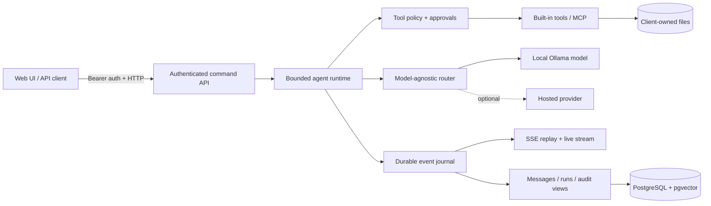

# Sovereign AI Workspace

> A self-hosted, model-agnostic AI workspace for organizations that need agentic AI without giving up control of their data, infrastructure, or model provider.

[](https://www.typescriptlang.org/)
[](https://nodejs.org/)
[](https://www.postgresql.org/)
[](https://ollama.com/)

Sovereign AI Workspace is an in-progress, enterprise-oriented AI platform designed to run inside a client's own network. It combines a model-agnostic LLM harness, bounded agent runtime, governed tool execution, durable storage, authenticated streaming APIs, and local-model deployment in one codebase.

The goal is a Claude-style workspace in which conversations, attachments, embeddings, audit records, and model inference can remain on infrastructure the organization controls. Models are configuration, not architecture: a deployment can use local Ollama models or a supported hosted provider without rewriting the product.

## Why this project matters

Most AI workspaces create two forms of lock-in: product data is stored in the vendor's cloud, and application logic becomes coupled to one model provider. That is a poor fit for regulated or security-sensitive environments.

This project approaches the problem differently:

- **Data sovereignty** — messages, files, embeddings, approvals, and audit events are designed to stay on client-owned infrastructure.
- **Model portability** — provider quirks are isolated behind configuration and verified with conformance evidence.
- **Governed agency** — tools are policy-controlled, approval-aware, bounded by deadlines, and audited before execution.
- **Operational honesty** — support is based on dated verification artifacts, not a long list of nominal integrations.

## What is implemented

| Area | Capabilities |
| --- | --- |
| Model layer | Config-driven routing, OpenAI-compatible provider registration, local Ollama integration, context budgeting, usage accounting, and measured model sizing |
| Agent runtime | Bounded multi-turn runs, cancellation, typed lifecycle events, streaming transport, tool dispatch, and deterministic context compilation |
| Tools | Scoped filesystem, search, shell, and HTTP tools; MCP client support; capability policies and approval suspension/resume |
| Persistence | PostgreSQL repositories, pgvector search, versioned message envelopes, attachments, durable event journal/outbox, and verified erasure workflows |
| Server | Bearer authentication, durable sessions and revocation, RBAC, idempotent commands, SSE replay, product reads, rate/token/spend controls, and audit projections |
| Deployment | Docker Compose topology with local Ollama, PostgreSQL/pgvector, immutable migrations, readiness checks, encrypted event spooling, backup, and an air-gapped path |
| Verification | Provider swap, cache, admission, embeddings, model-load, performance, residency, truncation, and deployment verification scripts |

## Architecture



The runtime emits one typed event stream. Content-bearing events feed the user and persistence layers, while redacted projections feed operational logs and audit views. This keeps the product observable without copying sensitive content into every subsystem.

## Engineering highlights

- Fail-closed validation at configuration, context, tool-policy, model-admission, and request-control boundaries.
- Durable, caller-idempotent run commands and replayable SSE using `Last-Event-ID`.
- Complete conversation history in storage with a separately bounded provider context window.
- Local semantic search through pgvector and pinned Ollama embeddings.
- Model capability records that distinguish declared behavior from observed evidence.
- Internal-only database and inference services; the application server is the sole loopback ingress.
- Security-conscious container defaults: read-only filesystems, dropped capabilities, file-backed secrets, and no-new-privileges.
- 500 automated test cases across the harness, runtime, server, storage, policy, and deployment layers, including infrastructure-dependent integration coverage.
- Architecture decisions and correction history recorded as ADRs and dated conformance artifacts.

## Current status

This repository contains the product's backend and deployment foundation. The model harness, agent runtime, persistence layer, authenticated HTTP/SSE server, governance controls, and first single-node deployment are implemented.

The browser-based chat and administration UI is the next major product phase. This is therefore a substantial working backend, not yet a finished end-user application.

See [`product-roadmap.md`](product-roadmap.md) for the complete phase map and [`ADR-003-sovereign-workspace-product.md`](ADR-003-sovereign-workspace-product.md) for the product decision.

## Tech stack

- **Language/runtime:** TypeScript, Node.js 24+
- **LLM abstraction:** `@earendil-works/pi-ai`
- **Tool interoperability:** Model Context Protocol SDK
- **Data:** PostgreSQL 18, pgvector, local attachment storage
- **Local inference:** Ollama; the supported single-node profile pins Qwen3 4B
- **Transport:** HTTP + Server-Sent Events
- **Deployment:** Docker Engine and Docker Compose
- **Testing:** Node's built-in test runner and TypeScript compiler

## Local development

### Prerequisites

- Node.js 24 or newer
- npm
- Ollama only for live local-model verification
- PostgreSQL only for storage integration tests

```bash
git clone https://github.com/sarmadAli0380/sovereign-ai-workspace.git
cd sovereign-ai-workspace
npm ci
npm run typecheck
npm test
```

The unit suite runs without provider credentials. Some integration tests require PostgreSQL, Linux filesystem behavior, or other deployment services.

### Useful verification commands

```bash
npm run verify              # live provider behavior
npm run verify:cache        # prompt-cache conformance
npm run verify:admission    # local model admission
npm run verify:embeddings   # local embedding route
npm run verify:model-load   # cold/warm model loading
npm run verify:performance  # performance baseline
npm run verify:deployment   # static deployment topology gate
npm run verify:residency    # residency and recovery evidence
npm run verify:truncation   # context truncation behavior
```

Live verification requires the corresponding provider and credentials. Results are written as machine-readable, dated evidence under [`conformance/`](conformance/).

## Single-node deployment

The first supported topology targets a Linux Docker host with PostgreSQL/pgvector and Ollama running on an internal-only Compose network.

```bash
cp deployment/env.example .env
umask 077
openssl rand -hex -out deployment/secrets/database_password 32
openssl rand -hex -out deployment/secrets/spool_key 32
# Create deployment/secrets/session_registry as documented in deployment/secrets/README.md
./deployment/bin/single-node.sh up
./deployment/bin/single-node.sh verify
```

Before starting the service, replace `DEPLOYMENT_ADMISSION_FREE_BYTES` with a current measurement from the target host. The application deliberately refuses to guess whether a model fits.

The server binds to `127.0.0.1:8080` by default. Use an approved TLS terminator or client-network tunnel before exposing it beyond the host. For operational details, backup/restore expectations, authentication, and air-gapped provisioning, read [`deployment/README.md`](deployment/README.md).

## Repository map

```text
src/
├── context/          deterministic prompt and context compilation
├── deployment/       deployment configuration and topology policy
├── mcp/              Model Context Protocol client adapter
├── messages/         versioned product message contracts
├── model-control/    capabilities, sizing, and admission
├── search/           local embeddings and retrieval
├── server/           auth, command gateway, controls, reads, HTTP/SSE
├── storage/          PostgreSQL, journal, attachments, erasure, migrations
└── tools/            governed built-in tools

scripts/              verification, sizing, login, and server entry points
deployment/           single-node and air-gapped deployment assets
conformance/          dated machine-readable verification evidence
phase*/adrs/          architecture decision records by delivery phase
```

## Design principles

1. **Client infrastructure is the trust boundary.** Sovereignty includes embeddings, logs, caches, and backups—not only chat messages.
2. **A model is supported only after conformance testing.** Provider marketing claims are not runtime evidence.
3. **Agent actions are explicit security decisions.** Every tool declares controls and can be denied, approved, bounded, or audited.
4. **Durability is part of correctness.** Commands, approvals, event replay, and deletion remain coherent across restarts and partial failures.
5. **Product architecture is owned; security primitives are not reinvented.** Maintained infrastructure libraries sit behind product-owned interfaces.

## Roadmap

- Build the web chat and administration interface.
- Expand dated provider/model conformance coverage.
- Complete target-host, TLS-ingress, accelerator, and restore-rehearsal evidence.
- Package governance views for audit and regulatory workflows.
- Add per-client branding, policies, data sources, and onboarding automation.

## Author

Built by [Sarmad Ali](https://github.com/sarmadAli0380) as an exploration of what an enterprise AI workspace looks like when model portability, security boundaries, and data residency are architectural requirements rather than add-ons.

